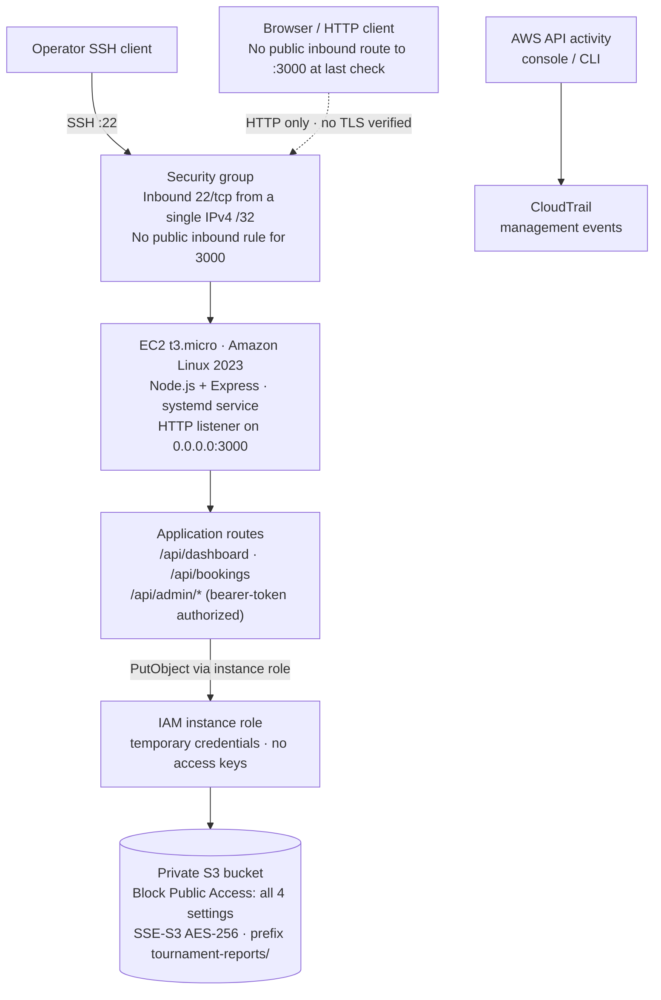

# Pickleball Cloud Security

**Secure Pickleball Court Management System using AWS cloud security best practices** — a college mini-project demonstrating how IAM least privilege, encrypted private storage, network restriction, and audit logging protect a small web application in the cloud.

[](https://nodejs.org/)
[](https://expressjs.com/)
[](https://aws.amazon.com/)
[](#running-tests)
[](LICENSE)

> **Scope note:** this is a security demonstration with fictional data. It is not a production booking platform. Admin access uses a prototype shared bearer token — not an authentication system — and the app is served over HTTP only.

---

## Table of Contents

- [Project Overview](#project-overview)
- [Problem Statement & Academic Relevance](#problem-statement--academic-relevance)
- [Key Features](#key-features)
- [Architecture](#architecture)
- [Security Controls](#security-controls)
- [Technology Stack](#technology-stack)
- [Repository Structure](#repository-structure)
- [Prerequisites](#prerequisites)
- [Local Installation & Development](#local-installation--development)
- [Environment Configuration](#environment-configuration)
- [Running Tests](#running-tests)
- [AWS Deployment Overview](#aws-deployment-overview)
- [Security Verification & Evidence](#security-verification--evidence)
- [Cost Considerations](#cost-considerations)
- [Known Limitations](#known-limitations)
- [Future Improvements](#future-improvements)
- [License](#license)

---

## Project Overview

The application is a small Express web app for a fictional pickleball club. It presents a dashboard of courts, bookings and tournaments; accepts validated booking submissions; and exposes a server-side-authorized administrative API that can store tournament reports in Amazon S3.

The application code itself is deliberately simple. The project's value is in the **cloud security layer around it**: an EC2 instance role instead of access keys, a private encrypted S3 bucket, a restricted security group, management-event auditing with CloudTrail, and an automated test suite that proves the authorization and validation controls work.

**Status of claims in this README:** each security control below is labelled *Verified* (evidence available now), *Partially verified* (code or prior console check exists, but artifacts are not committed to this repository), or *Planned*. No control is described as production-grade.

---

## Problem Statement & Academic Relevance

> How can AWS cloud security best practices be implemented to protect a Pickleball Court Management System from unauthorized access, data breaches, cloud misconfigurations, and security threats?

| Syllabus area | Where it appears in this project |
|---|---|
| Identity & Access Management | EC2 instance role with a least-privilege S3 policy; no access keys in code or Git |
| Secure cloud architecture | Single small EC2 instance, security-group-restricted network exposure |
| Data protection & encryption | Private S3 bucket, SSE-S3 (AES-256) at rest, encrypted EBS root volume |
| Cloud misconfigurations | Controlled finding-then-remediation exercise on an isolated test policy *(evidence pending)* |
| Monitoring & logging | CloudTrail management-event evidence for API activity |
| Cloud security best practices | Least privilege, defence in depth, secret hygiene, honest documentation of limitations |

---

## Key Features

- **Dashboard** — fictional courts, upcoming bookings and tournaments rendered with no server-side secrets
- **Booking submission** — strict server-side validation (name/email/date/time/duration rules) plus double-booking rejection with HTTP 409
- **Administrative API** — every admin endpoint enforces a server-side bearer-token check; requests without the token receive HTTP 403 even when called directly with `curl`
- **Tournament report storage** — authorized uploads go to an S3 `tournament-reports/` prefix via the EC2 instance role, or to a local directory in development mode
- **Hardened HTTP behaviour** — Helmet security headers (CSP, `X-Frame-Options`, `nosniff`, `Referrer-Policy`), 10 KB JSON body limit, centralized error handling that never returns stack traces to clients
- **Automated test suite** — 23 tests covering validation, authorization and API behaviour

---

## Architecture



**Network exposure.** The security group allows inbound SSH (22/tcp) from a single IPv4 `/32` source only. No public inbound rule for the application port (3000) was present at the last console check — so the diagram deliberately shows no public browser-to-app connection. Outbound traffic is unrestricted (needed for package updates, S3 and AWS API calls); this is a documented trade-off, not an oversight to hide.

**HTTP vs HTTPS.** The application listens on plain HTTP port 3000. No valid HTTPS endpoint (TLS certificate, Application Load Balancer or CloudFront) has been implemented or verified. HTTPS is future work.

---

## Security Controls

| Area | Implemented control | Evidence / verification | Status |
|---|---|---|---|
| IAM & credentials | EC2 instance role; SDK default credential chain; no access keys anywhere in the repo | Code: `src/services/storage.js`; role deployment reported by operator | Partially verified |
| Least-privilege S3 access | Role restricted to `s3:PutObject` on the `tournament-reports/` prefix | Operator-reported; **policy JSON not committed to this repository** | Partially verified |
| S3 Block Public Access | All four account/bucket public-access settings enabled | Operator console check; no repo artifact | Partially verified |
| S3 encryption at rest | SSE-S3 (AES-256) as bucket default; per-object `ServerSideEncryption: AES256` in code | Code verified; bucket setting operator-reported | Partially verified |
| EC2 volume encryption | Encrypted EBS root volume | Operator console check at launch | Partially verified |
| Security group restriction | SSH limited to one `/32` source; no public inbound rule for :3000 | Operator console check | Partially verified |
| Admin API authorization | Server-side bearer token, constant-time comparison, 403 on missing/wrong token | Automated tests (`tests/api.test.js`) — pass | **Verified** |
| Input validation | Regex + length + domain checks; credential-material rejection on uploads | Automated tests (`tests/validator.test.js`) — pass | **Verified** |
| Security headers | Helmet with CSP, frame/deny options, `nosniff`, referrer policy | Config in `src/app.js`; headers confirmed in local responses | **Verified** (local) |
| Error handling | Centralized handler; internals never sent to clients | Code review of `src/middleware/errorHandler.js` | Implemented |
| Git secret hygiene | `.env`, `*.pem`, `*.key`, `credentials`, `local-storage/` ignored; no secret files tracked | `git ls-files` inspection | **Verified** |
| Automated tests | 23 tests: validation, authz, double-booking, headers, 404 handling | Suite executed at README revision: 23 pass / 0 fail | **Verified** (local) |
| CloudTrail auditing | Management-event evidence collected for AWS API activity | Operator-reported evidence; trail configuration not in repo | Partially verified |
| CloudWatch alarm / SNS | — | Not implemented | **Planned** |
| HTTPS | — | Not implemented | **Planned** |
| IAM user with MFA (admin demo) | — | Not evidenced in repository | **Planned** |

---

## Technology Stack

| Layer | Choice | Notes |
|---|---|---|
| Runtime | Node.js ≥ 20 | Development on Node 22 LTS; deployed runtime observed as 20.20.2 |
| Web framework | Express 4.x | `src/app.js` — Helmet, JSON body limit, static files |
| Frontend | Vanilla HTML/CSS/JS | Dynamic content rendered via `textContent` only (no `innerHTML`) |
| AWS SDK | `@aws-sdk/client-s3` v3 | Loaded only when `STORAGE_MODE=s3` |
| Tests | Built-in `node:test` runner | Zero extra test dependencies |
| Hosting | Amazon EC2 `t3.micro`, Amazon Linux 2023 | Managed by systemd (`pickleball-app`) |
| Storage | Amazon S3 | Private, encrypted, `tournament-reports/` prefix |
| Audit | AWS CloudTrail | Management events |

---

## Repository Structure

```
pickleball-cloud-security/
├── src/
│   ├── server.js               # Bootstrap and listen on PORT (default 3000)
│   ├── app.js                  # Express app, Helmet headers, body limits
│   ├── routes/api.js           # Dashboard, booking, and admin endpoints
│   ├── middleware/
│   │   ├── adminAuth.js        # Server-side bearer-token authorization
│   │   ├── errorHandler.js     # Centralized, leak-free error responses
│   │   └── notFoundHandler.js  # JSON 404
│   ├── services/
│   │   ├── dataStore.js        # Fictional in-memory courts/bookings/tournaments
│   │   ├── validator.js        # Server-side input validation
│   │   └── storage.js          # Local ⇄ S3 storage switch (instance role on EC2)
│   └── public/                 # index.html · styles.css · app.js
├── tests/
│   ├── validator.test.js       # Validation unit tests
│   └── api.test.js             # End-to-end API + authorization tests
├── aws-config/                 # Reserved for IAM/EC2/S3 evidence artifacts (currently empty)
├── monitoring/                 # Reserved for CloudTrail/CloudWatch artifacts (currently empty)
├── security-tests/             # Reserved for manual security-test evidence (currently empty)
├── docs/                       # Reserved for report & presentation (currently empty)
├── .env.example                # Documented configuration template (no secrets)
├── .gitignore                  # Blocks .env, keys, credentials, local-storage/
├── LICENSE                     # MIT
└── package.json
```

---

## Prerequisites

- **Node.js ≥ 20** and npm — <https://nodejs.org>
- **Git**
- An **AWS account** only if you follow the deployment stages; the application runs fully locally without one

---

## Local Installation & Development

```bash
git clone https://github.com/Harmann60/pickleball-cloud-security.git
cd pickleball-cloud-security
npm install
cp .env.example .env    # optional — defaults work for local mode
npm start               # serves http://localhost:3000
```

Development mode with automatic restart on file changes:

```bash
npm run dev
```

In local mode (`STORAGE_MODE=local`) tournament-report uploads are written to `local-storage/` on disk. No AWS credentials are required or used.

> **Never** commit `.env` files, private keys, or real AWS credentials to this repository. The `.gitignore` blocks the common patterns, but treat every secret as your responsibility.

---

## Environment Configuration

| Variable | Default | Purpose |
|---|---|---|
| `PORT` | `3000` | HTTP listen port |
| `STORAGE_MODE` | `local` | `local` = file store; `s3` = Amazon S3 via instance role |
| `AWS_S3_BUCKET` | — | Target bucket name (required when `STORAGE_MODE=s3`) |
| `AWS_REGION` | `ap-south-1` (SDK fallback) | Set explicitly on EC2 to match the deployment region |
| `ADMIN_TOKEN` | random per process | Bearer token for `/api/admin/*`; if unset, a random token is generated and logged at startup |
| `NODE_ENV` | `development` | `production` hides internal error details from clients |

---

## Running Tests

```bash
npm test
```

Runs the built-in Node test runner over `tests/*.test.js`. Last execution at this README revision: **23 passed, 0 failed**.

Coverage highlights:

- Rejection of script-injection names, malformed emails, invalid dates/times, unknown courts, past dates and invalid durations
- Rejection of private-key material in report uploads
- Booking creation, double-booking conflict (HTTP 409), and invalid input (HTTP 400)
- Admin authorization: HTTP 403 without a token, HTTP 403 with a wrong token, HTTP 200 with the correct token
- Security response headers and JSON 404 handling

---

## AWS Deployment Overview

Deployment is performed step-by-step so every control can be inspected and evidenced. Reported state of the current deployment:

| Component | Reported state | Evidence in repo? |
|---|---|---|
| EC2 instance | `t3.micro`, Amazon Linux 2023, region `ap-northeast-1`, Node.js 20.20.2 | No |
| Process management | systemd service `pickleball-app`, app on port 3000 | No |
| IAM | Instance role `PickleballEC2S3Role` supplying temporary credentials | No (policy JSON not committed) |
| S3 | Private bucket; all four Block Public Access settings on; SSE-S3 default encryption | No |
| EBS | Encrypted root volume | No |
| Security group | Inbound 22/tcp from a single `/32`; no public inbound rule for 3000 | No |
| CloudTrail | Management-event evidence of AWS API activity | No (artifacts pending in `monitoring/`) |

None of the deployment artifacts above are version-controlled yet; they are recorded here from operator console checks and will be archived under `aws-config/` and `monitoring/` as evidence.

**Deployment pattern used on the instance** (for reference when evidence is archived):

```bash
# application directory owned by a dedicated user; node_modules from npm ci
# environment values written to the systemd unit or /etc/environment
sudo systemctl enable --now pickleball-app
sudo systemctl status pickleball-app
```

---

## Security Verification & Evidence

**Proven by the automated suite (repeatable locally):**

```bash
# admin endpoint without a token → HTTP 403
curl -s -o /dev/null -w '%{http_code}\n' http://localhost:3000/api/admin/bookings
# invalid booking payload → HTTP 400 with field-level errors
curl -s -X POST http://localhost:3000/api/bookings \
  -H 'Content-Type: application/json' \
  -d '{"playerName":"<script>x</script>","email":"bad","courtId":"ZZ","date":"2020-01-01","startTime":"99:99","durationMins":5}'
```

**Verified locally outside the suite:** Helmet security headers present on responses; server-side validation error messages returned as structured JSON.

**Operator-reported (console checks, artifacts not yet in this repository):** S3 Block Public Access, SSE-S3 encryption, encrypted root volume, security-group rules, CloudTrail management events, IAM role existence.

**Not yet performed:** live tests of anonymous S3 access denial, unencrypted-upload rejection by bucket policy, and CloudWatch/SNS alerting (not implemented). These are planned evidence items — this README does not claim them as done.

---

## Cost Considerations

This project was **designed** to sit inside AWS Free Tier limits, but costs are not guaranteed to be zero. Actual spend depends on your account's free-tier eligibility (12 months from account creation), region, usage patterns and current AWS pricing.

Typical free-tier allowances relevant to this design: EC2 `t3.micro` (750 hours/month), S3 storage and request volume far above this project's kilobyte-scale usage, and the first copy of CloudTrail management events. Services such as CloudWatch alarms, SNS notifications and data-transfer charges can incur small costs outside those allowances.

- **Billing alerts and budgets are notifications, not spending caps.** They warn you; they do not stop resources.
- The AWS console showed a `$0.00` estimate at a prior check, with credits available — a historical observation, not a promise.
- Every billable resource created during deployment (EC2 instance, S3 bucket, CloudTrail trail) must be deleted or emptied during cleanup. Terminate the instance, empty and delete the bucket, and delete the trail when the evaluation is complete.

---

## Known Limitations

- **HTTP only.** No TLS certificate or HTTPS endpoint has been implemented. Do not transmit real data over the current deployment.
- **Prototype authorization, not authentication.** Admin endpoints share one bearer token. There are no user accounts, password hashing, sessions, or lockout controls — deliberately out of scope and labelled as a prototype.
- **In-memory data store.** Bookings exist only in process memory and reset when the service restarts. No database is used.
- **Single instance.** No multi-AZ redundancy, autoscaling or load balancing.
- **Unrestricted outbound traffic** from the instance (needed for updates and AWS APIs).
- **Deployment artifacts are not in the repository yet.** IAM policy JSON, security-group definitions, trail configuration and console evidence are reported but not archived here.
- **`AWS_REGION` must be set explicitly on EC2.** The SDK fallback in `storage.js` is `ap-south-1`, while the deployment region is `ap-northeast-1` — a mismatch would fail S3 calls.
- **Not penetration-tested or audited.** Passing unit tests does not prove the absence of vulnerabilities.

---

## Future Improvements

- HTTPS via ACM certificate and a CloudFront or Application Load Balancer front end
- AWS-managed user authentication (e.g. Cognito) replacing the prototype token
- Amazon RDS or DynamoDB with parameterized queries for persistent bookings
- CloudWatch metric filter + alarm + SNS notification for sensitive API activity
- Committed evidence artifacts: IAM policy JSON, security-group rules, CloudTrail excerpts, misconfiguration before/after screenshots
- AWS Config / GuardDuty and an S3 bucket policy enforcing `aws:SecureTransport` and `aws:Referer`/encryption conditions
- CI pipeline running the test suite and secret scanning on every push

---

## License

[MIT](LICENSE) © Harman
